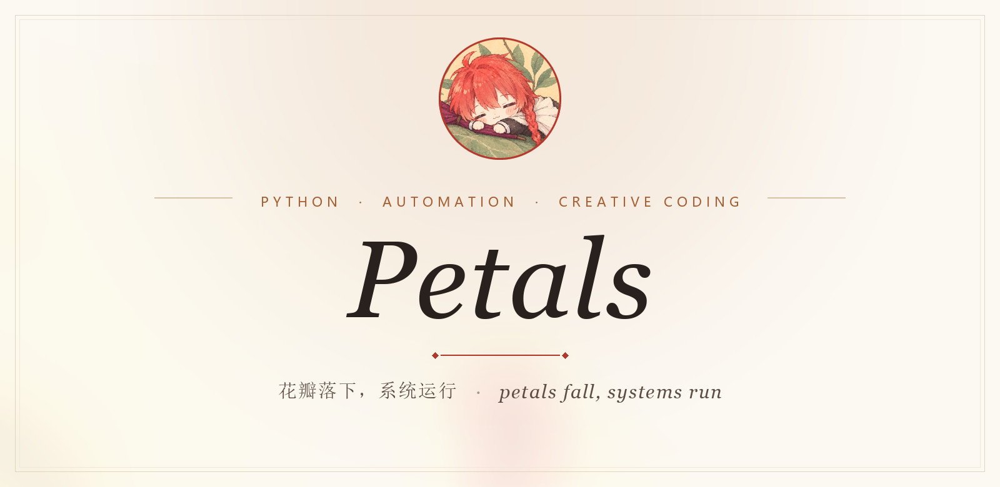
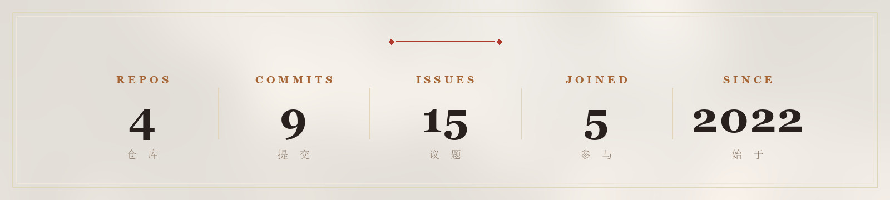

<picture>
  <source media="(prefers-color-scheme: dark)" srcset="./assets/hero-night.jpg">
  
</picture>

 

<picture>
  <source media="(prefers-color-scheme: dark)" srcset="./assets/poem-night.png">
  
</picture>

 

 

<h3 align="center">栈</h3>

 

<h3 align="center">做 什 么</h3>

<b>自动化</b> &nbsp;—&nbsp; 浏览器脚本、工作流助手、批处理小工具 
<b>网页</b> &nbsp;—&nbsp; 小页面、动效 SVG / CSS、简单看板 
<b>数据</b> &nbsp;—&nbsp; 清洗、解析、Excel / CSV 处理 
<b>AI 工具</b> &nbsp;—&nbsp; 提示词、模型封装、本地效率工具

 

 

<h3 align="center">数 据</h3>

<picture>
  <source media="(prefers-color-scheme: dark)" srcset="./assets/stats-night.jpg">
  
</picture>

 

 

&nbsp;&nbsp;&nbsp;
  
你爱的人永远死去，夕阳仍一直堆满大海。
  
<a href="https://github.com/Petalses">github.com/Petalses</a>

